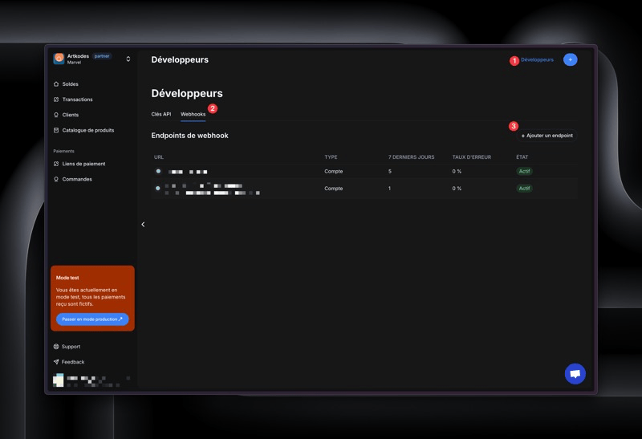

Webhooks allow your application to receive real-time notifications whenever specific events occur on your Yabetoo account. Instead of continuously polling the API to check for updates, you can configure webhooks to automatically receive event data as soon as it happens.

This mechanism is essential for reacting to payment lifecycle events such as `intent.succeeded`, `intent.failed` or `checkout.session.completed`, allowing your backend to stay in sync with the user's payment flow.

## How Webhooks Work

1. You register a **Webhook URL** in your dashboard or integration settings.
2. When an event occurs (e.g., a payment is confirmed), Yabetoo sends an HTTP `POST` request to your endpoint.
3. The request contains a **JSON payload** describing the event.
4. Your server must respond with a `200 OK` status to acknowledge receipt.

<Tip>
  **Security Tip:** You should always verify the webhook signature to ensure the
  request genuinely comes from Yabetoo.
</Tip>

## How to Create a Webhook Endpoint

Follow these steps to set up a webhook endpoint for your Yabetoo integration

<Card>
  
</Card>

### 1. Access the Developer Dashboard

- Log in to your Yabetoo dashboard.
- In the left-hand menu, click on **Developers**.

### 2. Open the Webhooks Tab

- Once on the Developer page, click on the **Webhooks** tab at the top (next to “API Keys”).

### 3. Add a New Endpoint

- Click on the ➕ **Add Endpoint** button located in the top right corner.

### 4. Configure the Webhook

- Enter the full URL of your webhook endpoint (e.g. `https://your-domain.com/webhook/yabetoo`).
- Choose the event types you want to subscribe to (e.g. `intent.succeeded`, `intent.failed`, `checkout.session.completed`). The full list is in [Supported events](/en/developer-tools/webhook/events).
- Click on **Save** to register your webhook.

<Warning>
  Event names are not checked when you register an endpoint: a misspelled name (for example
  `intent.completed`) is accepted, but matches no event and you will receive nothing. The `*`
  wildcard is accepted: `intent.*` receives every payment event.
</Warning>

<Note>
Your endpoint **must accept HTTP `POST` requests** from Yabetoo and respond with a `2xx` code within **30 seconds**. Respond first, then process the event.

If your server does not respond in time, or responds `408`, `429`, `500`, `502`, `503` or `504`, Yabetoo **retries** the delivery: 7 attempts in total, after 1 min, 5 min, 30 min, 2 h, 8 h and then 24 h. Other codes (for example `400` or `404`) stop the attempts.

The same event can therefore arrive more than once: use its `id` to ignore duplicates.
</Note>

## Webhook Security Headers

Each webhook request sent by Yabetoo includes a set of custom HTTP headers that allow you to:

- Verify the **authenticity** of the request.
- Identify the **type of event**.
- Track individual webhook **deliveries**.
- Prevent **replay attacks** using the timestamp.

Below is a list of headers you should expect and handle:

| Header Name                   | Description                                                                                                    |
| ----------------------------- | -------------------------------------------------------------------------------------------------------------- |
| `X-Yabetoo-Webhook-Signature` | The HMAC-SHA256 signature, in hexadecimal, computed with your webhook secret. Used to verify that the payload was not modified. |
| `X-Yabetoo-Webhook-Timestamp` | The Unix timestamp (in seconds) when the request was sent. Use this to prevent replay attacks.                 |
| `X-Yabetoo-Webhook-Event`     | The event type (e.g. `intent.succeeded`). Same as the body's `type` field. |
| `X-Yabetoo-Webhook-Id`        | The event identifier (`evt_…`), same as the body's `id` field and the same across attempts. Use it to ignore duplicates. |

---

### Example of Raw Headers

```http
POST /webhook/yabetoo HTTP/1.1
Host: your-domain.com
Content-Type: application/json
X-Yabetoo-Webhook-Signature: bb8f4e3a6a9d...
X-Yabetoo-Webhook-Timestamp: 1713108000
X-Yabetoo-Webhook-Event: intent.succeeded
X-Yabetoo-Webhook-Id: evt_3kQ9xV2mLp7RtY8sWb4nZc1d
```

## Verifying Webhook Signatures

To ensure that webhook requests are legitimately sent by Yabetoo and have not been tampered with, you must verify the signature included in the `X-Yabetoo-Webhook-Signature` header.

### Verification Steps

Follow the steps below to securely validate incoming webhook requests:

### 1. Retrieve Your Webhook Secret

Get your **Webhook Secret** from your Yabetoo dashboard under the Webhooks section. This secret is used to compute the HMAC signature.

### 2. Extract the Signature and Timestamp

From the request headers, extract the following:

- `X-Yabetoo-Webhook-Signature` — the signature in hexadecimal, e.g.: `abcdef1234567890abcdef1234567890…`
- `X-Yabetoo-Webhook-Timestamp` — the timestamp used in the signature

### 3. Build the Signed Payload

Create the string to sign by concatenating:

```text
{timestamp}.{raw_body}
```

Where:

- `timestamp` = value from `X-Yabetoo-Webhook-Timestamp`
- `raw_body` = the exact raw request body, as a UTF-8 string (before parsing JSON)

**Example:** `1713108000.{"id":"evt_3kQ9xV2mLp7RtY8sWb4nZc1d","type":"intent.succeeded",…}`

### 4. Compute the HMAC Signature

Compute the HMAC using **SHA-256** with your webhook secret as the key:

```javascript
const crypto = require("crypto");

const secret = "your_webhook_secret";
const payload =
  '1713108000.{"id":"evt_3kQ9xV2mLp7RtY8sWb4nZc1d","type":"intent.succeeded",…}';
const hmac = crypto.createHmac("sha256", secret).update(payload).digest("hex");
```

### 5. Compare the HMAC

Compare the computed HMAC with the value from `X-Yabetoo-Webhook-Signature`.

Use a **constant-time comparison**. This helps prevent timing attacks. Also reject a request whose timestamp is more than 5 minutes old, to block replays.

If the signatures match, the request is authentic and can be trusted.

---

### JavaScript Example (Node.js, Express)

The signature covers the **raw body** of the request. Do not compute it over `JSON.stringify(req.body)`: a re-encoded object can differ from the original and verification would fail.

```js
const crypto = require("crypto");
const express = require("express");

const app = express();

app.post("/webhook/yabetoo", express.raw({ type: "application/json" }), (req, res) => {
  const signature = req.header("X-Yabetoo-Webhook-Signature") ?? "";
  const timestamp = req.header("X-Yabetoo-Webhook-Timestamp") ?? "";
  const rawBody = req.body.toString("utf8");

  const expected = crypto
    .createHmac("sha256", process.env.YABETOO_WEBHOOK_SECRET)
    .update(`${timestamp}.${rawBody}`)
    .digest("hex");

  const fresh = Math.abs(Date.now() / 1000 - Number(timestamp)) < 300;
  const valid =
    signature.length === expected.length &&
    crypto.timingSafeEqual(Buffer.from(signature), Buffer.from(expected));

  if (!fresh || !valid) return res.status(400).send("Invalid signature");

  res.status(200).send("OK");

  const event = JSON.parse(rawBody);
  if (event.type === "intent.succeeded") {
    // event.data.intent.metadata.orderId → mark the order as paid
  }
});
```
