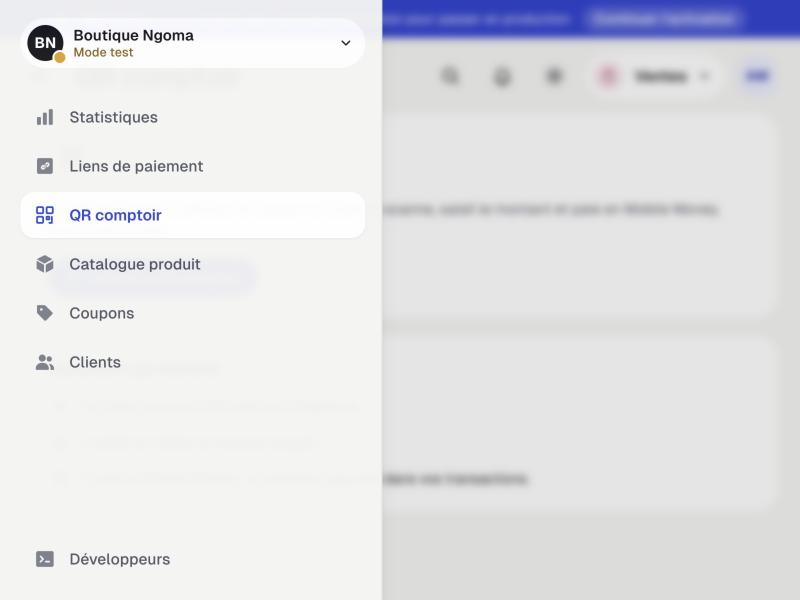
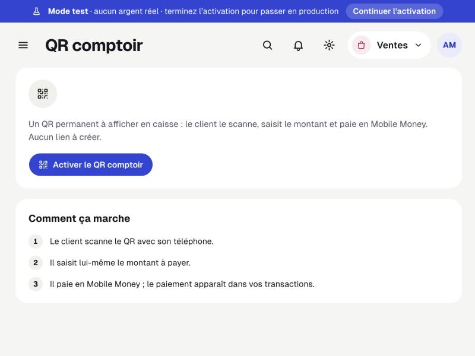
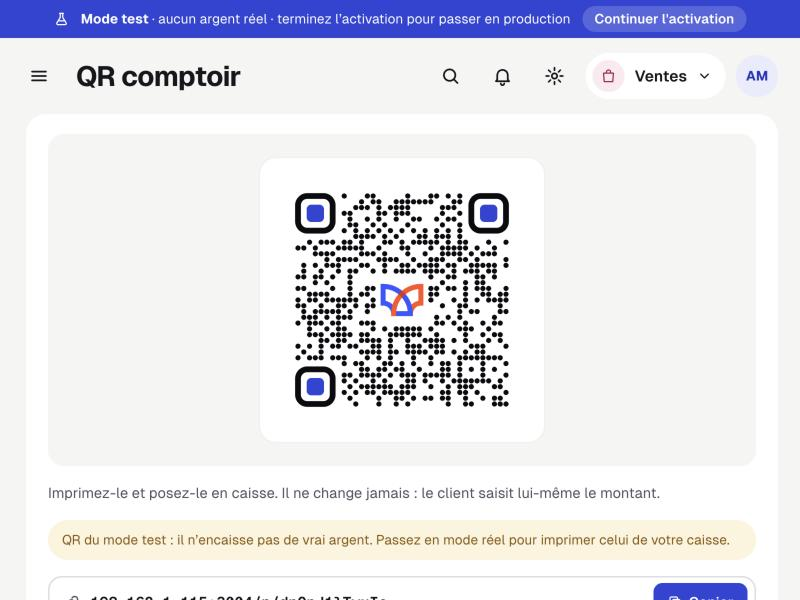
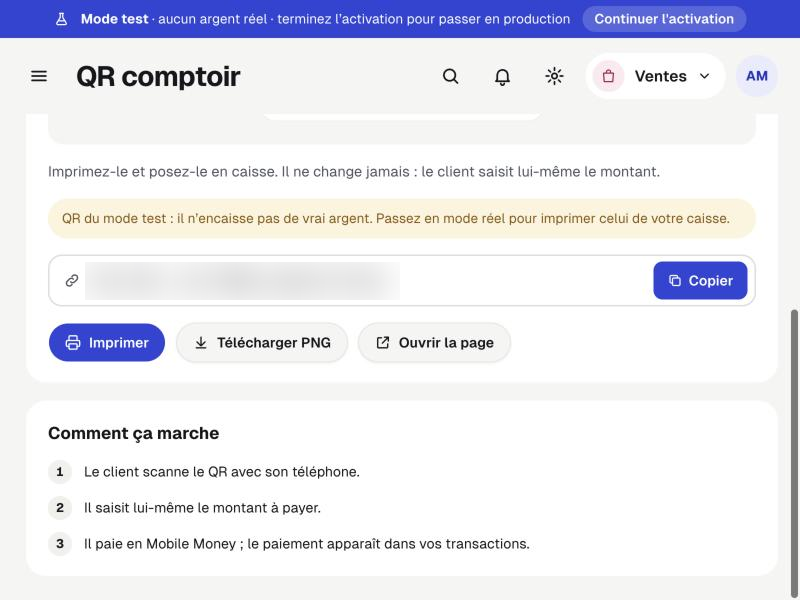
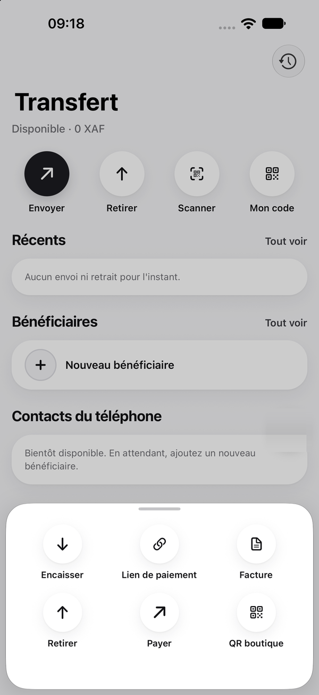
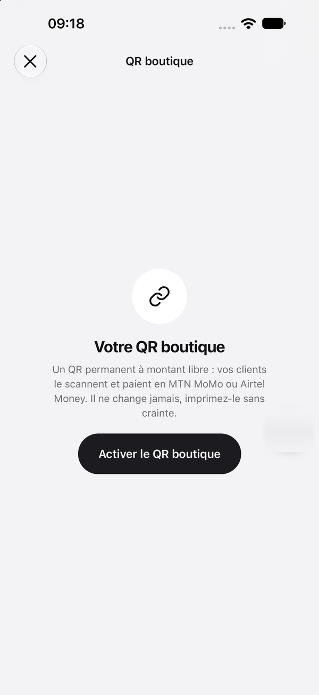
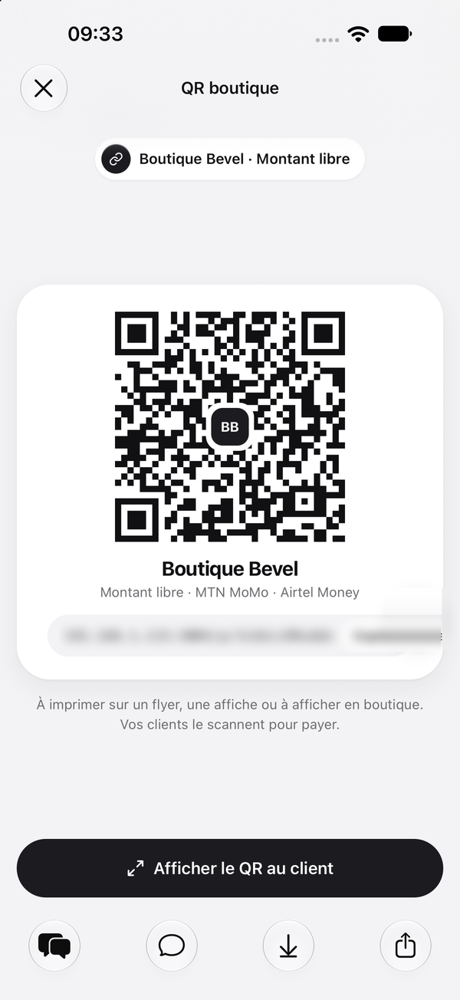
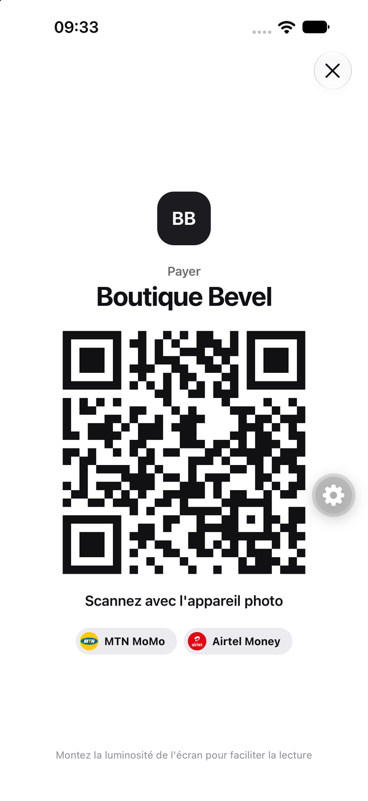
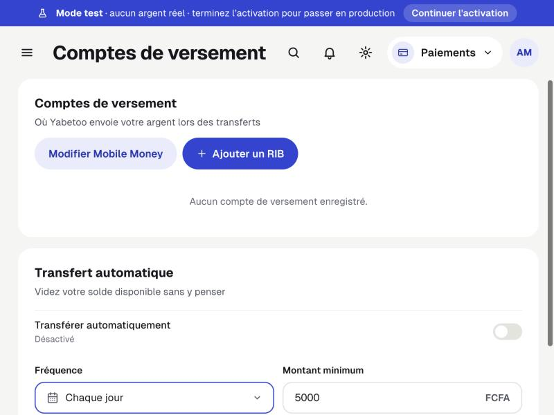
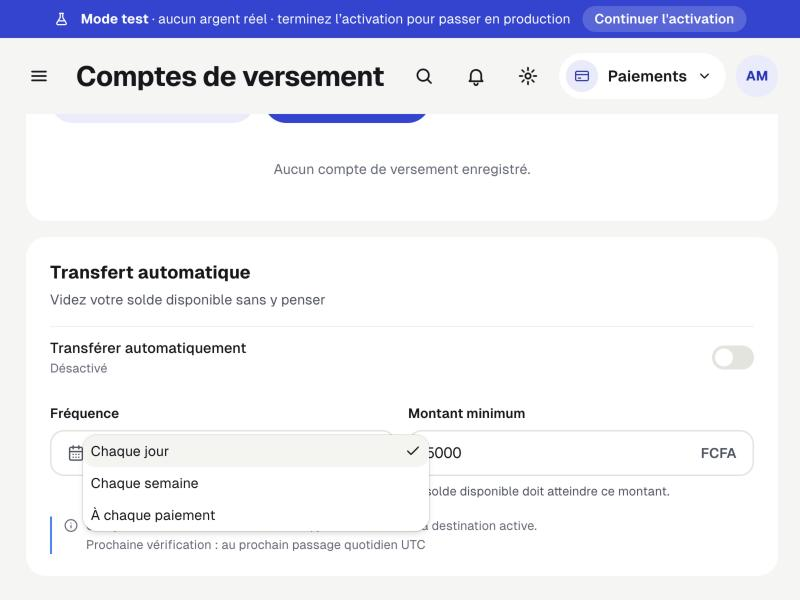

The counter QR is a **permanent** QR code that belongs to your shop. Print it once and put it at the till: the customer scans it with their phone, **enters the amount themselves** and pays with MTN MoMo or Airtel Money. No link to create, no change to give, and the QR never changes.

<Info>
Until your account is activated, a "Test mode · no real money" banner is shown: nothing you do collects real money. The screenshots on this page were taken in test mode, with the interface in French.
</Info>

## From the dashboard

<Steps>
  <Step title='Open "QR comptoir"'>
    Sign in at [app.yabetoo.com](https://app.yabetoo.com). In the **Sales** space, click **QR comptoir** in the menu (on a phone, open the menu with the three-line button at the top left).
    <Frame></Frame>
  </Step>
  <Step title="Activate your QR">
    Click **Activer le QR comptoir**. Yabetoo creates your QR in a second, nothing else to fill in.
    <Frame></Frame>
  </Step>
  <Step title="Your QR is ready">
    The QR carries the Yabetoo emblem. It stays the same forever, so you can print it safely.
    <Frame></Frame>
  </Step>
  <Step title="Print or download it">
    **Print** for a poster at the till, **Download PNG** for a flyer or sticker, **Copy** to send the payment link by WhatsApp or SMS.
    <Frame></Frame>
  </Step>
</Steps>

<Warning>
In test mode the page shows "QR du mode test". Once your account is activated, come back to this page: print **the live-mode QR** to collect real payments.
</Warning>

## From the Yabetoo Business app

In the app, the counter QR is called **"QR boutique"**. It is the same QR as on the dashboard.

<Steps>
  <Step title='+ button, then "QR boutique"'>
    Tap the **+** button at the bottom of the screen, then **QR boutique**.
    <Frame></Frame>
  </Step>
  <Step title="Activate it">
    Tap **Activer le QR boutique**.
    <Frame></Frame>
  </Step>
  <Step title="Share or save it">
    Send it by WhatsApp or SMS, download the image, or copy the link.
    <Frame></Frame>
  </Step>
  <Step title="Show it to the customer">
    **Afficher le QR au client** shows it full screen: the customer scans it straight from your phone.
    <Frame></Frame>
  </Step>
</Steps>

## Get paid out after every payment

By default, collected money stays on your Yabetoo balance. With the **"After every payment"** payout, Yabetoo sends it to your Mobile Money number right after each payment. Your operator's SMS ("You have received…") is your confirmation: no need to look at the customer's screen.

<Steps>
  <Step title="Save your Mobile Money number">
    In the **Payments** space, open **Comptes de versement** (payout accounts) and tap **Modifier Mobile Money** to set the number that receives the money.
    <Frame></Frame>
  </Step>
  <Step title='Choose "À chaque paiement"'>
    Under **Transfert automatique**, turn on **Transférer automatiquement** and pick the **À chaque paiement** (after every payment) frequency. The minimum amount is the balance from which money is sent.
    <Frame></Frame>
  </Step>
</Steps>

<Info>
Automatic payouts only work in **live mode**, once your account is verified. Each payout follows the usual withdrawal fee. You can switch back to daily or weekly at any time.
</Info>

## What your customer sees

1. They scan the QR with their phone camera.
2. A Yabetoo page opens with your name: they enter the amount to pay.
3. They choose MTN MoMo or Airtel Money and confirm with their PIN on their phone.
4. The payment shows up in your transactions (and, with "after every payment", lands on your Mobile Money).
