Yabetoo POS turns the **ZCS Z91** Android terminal into a till: collect an open amount or items from your catalogue, by Mobile Money or QR, and the receipt prints by itself. The screenshots show the interface in French.

## Before you start

- a Z91 terminal, charged and online (Wi-Fi or SIM card);
- the **Yabetoo POS** app on the terminal: the Yabetoo team installs it on delivery. If the icon is missing, contact Yabetoo support;
- your Yabetoo account (dashboard or Yabetoo Business app).

App updates install by themselves: they download in the background and apply the next time the app restarts, never during a sale.

## 1. Link the terminal to your account

<Steps>
  <Step title="The terminal shows a code">
    Open Yabetoo POS: an 8-digit code and a QR appear. The code is valid for 10 minutes (otherwise tap "Générer un nouveau code").
    <Frame>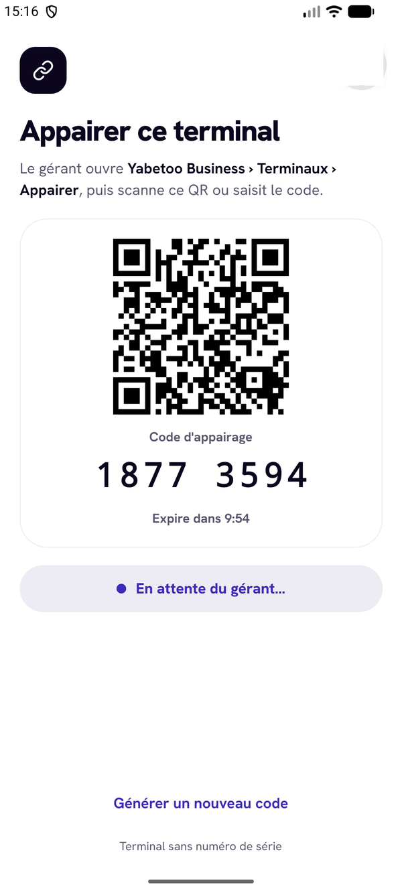</Frame>
  </Step>
  <Step title='Open "Terminaux POS"'>
    On the dashboard, go to **Settings › Terminaux POS** and click **Appairer un terminal** (pair a terminal).
    <Frame>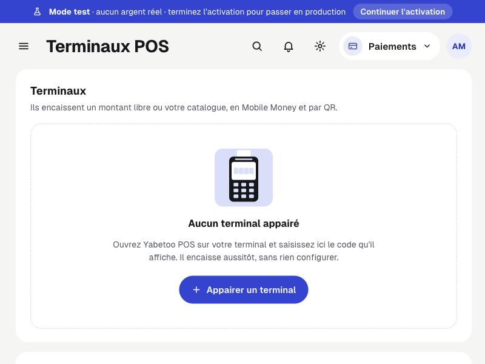</Frame>
  </Step>
  <Step title="Enter the code and name the till">
    Type the code shown by the terminal, give it a name ("Caisse 1") and click **Appairer**. The terminal connects by itself within seconds.
    <Frame>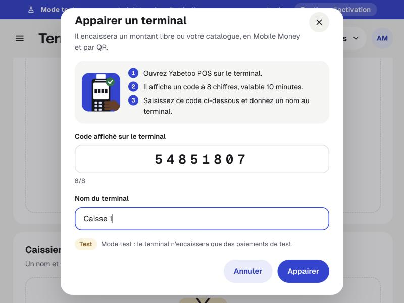</Frame>
  </Step>
</Steps>

<Tip>
From the Yabetoo Business app it's the same path: **Paramètres › Terminaux › Appairer un terminal**, then scan the QR shown by the terminal or type its code.
</Tip>

## 2. Create your cashiers

Everyone who takes payments has a name and a PIN. Cashiers apply to every terminal on the account.

<Steps>
  <Step title="Add a cashier">
    In **Terminaux POS**, click **Ajouter un caissier**: name, role and a 4 to 6-digit PIN (no runs like 1234, no repeated digits). A **Responsable** (manager) can also approve refunds with their PIN.
    <Frame>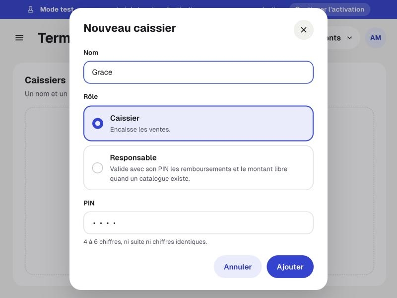</Frame>
  </Step>
  <Step title="All set">
    The terminal shows as **Actif** and your cashiers are listed. You can revoke a lost terminal or edit a cashier at any time.
    <Frame>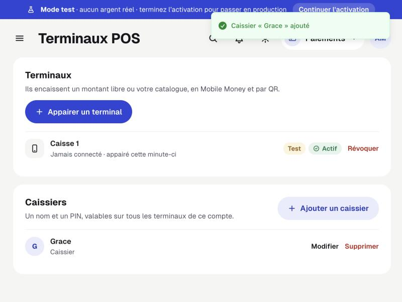</Frame>
  </Step>
</Steps>

## 3. Take a payment

<Steps>
  <Step title="The cashier signs in">
    At the start of their shift, they pick their name and type their PIN. Forgot the PIN? Ask the manager.
    <Frame>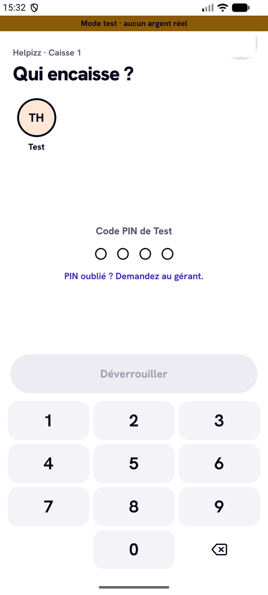</Frame>
  </Step>
  <Step title="Enter the amount or add items">
    Type the amount on the keypad (and a label if needed), or use the **Catalogue** tab: the cart fills up at the bottom of the screen.
    <CardGroup cols={2}>
      <Frame>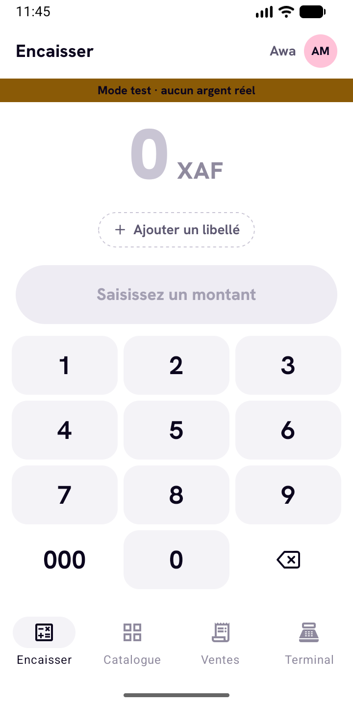</Frame>
      <Frame>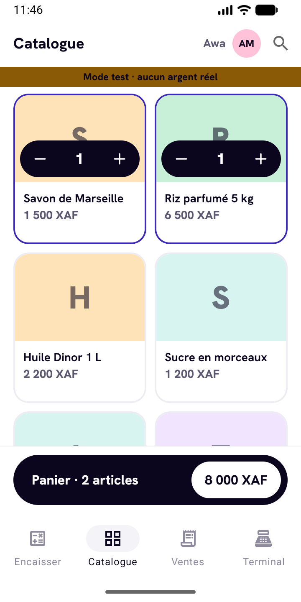</Frame>
    </CardGroup>
  </Step>
  <Step title="Choose the payment method">
    **Mobile Money** (the customer confirms on their phone) or **QR code** (the customer scans and pays).
    <Frame>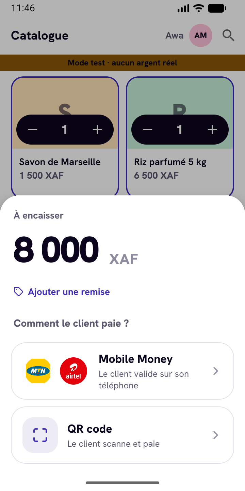</Frame>
  </Step>
  <Step title="Mobile Money: payment received, receipt printed">
    Enter the customer's number and tap **Demander**. The customer confirms with their PIN; as soon as the operator confirms, the screen turns green and the receipt prints. Tap **Nouvelle vente** for the next sale.
    <CardGroup cols={2}>
      <Frame>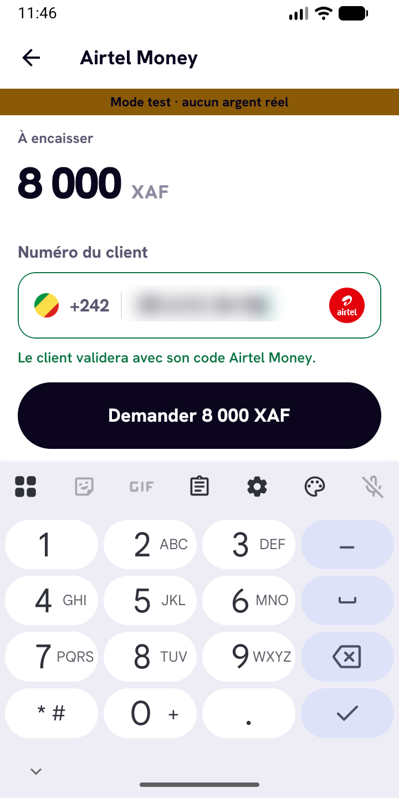</Frame>
      <Frame>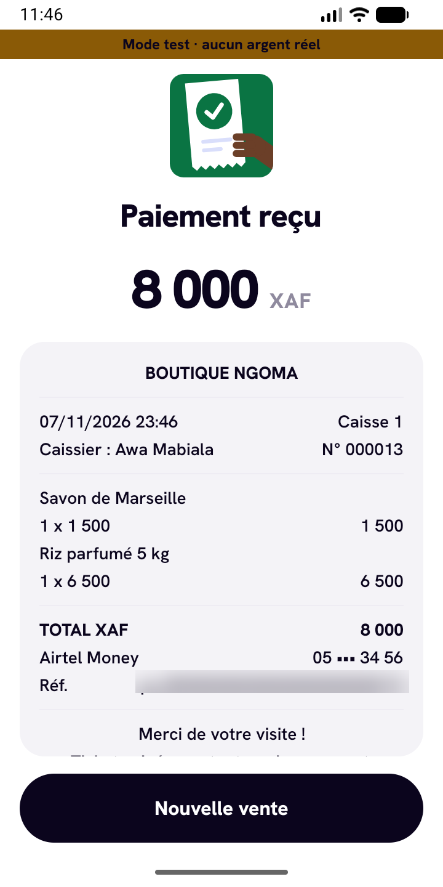</Frame>
    </CardGroup>
  </Step>
</Steps>

### On-screen QR (dynamic QR)

If the customer prefers to scan, choose **QR code**: the terminal shows a QR **for the exact sale amount**, different for every sale (unlike the [counter QR](/en/payments/in-store/counter-qr), which is permanent with an open amount). It stays valid for a few minutes; "Annuler" does not close the sale, the QR remains payable until it expires. The terminal detects the payment by itself and prints the receipt.

<CardGroup cols={2}>
  <Frame>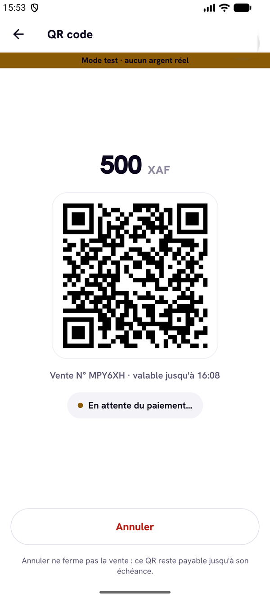</Frame>
  <Frame>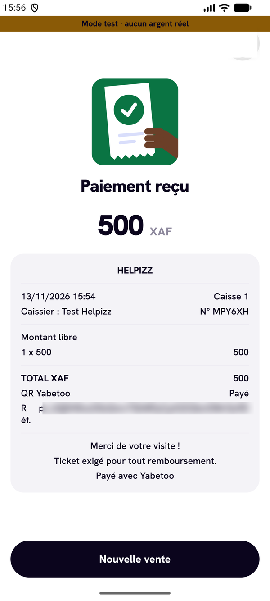</Frame>
</CardGroup>

## Terminal modes

A terminal paired from your Yabetoo account (dashboard or Yabetoo Business) runs in **normal mode**: open amount and catalogue, Mobile Money or QR payment, no cash and no till to close. It takes payments right away, nothing to configure.

Restaurants pair their terminals from **Takumi**: the terminal then follows the venue's mode (quick service, table service, bar or digital menu), with cash, tables and kitchen.

<Info>
**Refund a sale.** Open the **Ventes** tab, tap the sale, then **Rembourser**: a manager's PIN is required, and the money goes back to the original payment method. Keep the receipt: it is required for any refund.
</Info>
