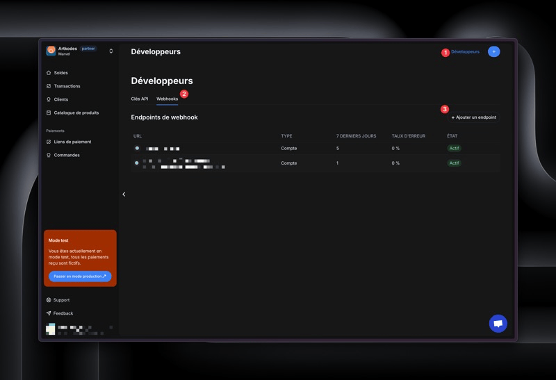

Les webhooks permettent à votre application de recevoir des notifications en temps réel chaque fois que des événements spécifiques se produisent sur votre compte Yabetoo. Au lieu d'interroger continuellement l'API pour vérifier les mises à jour, vous pouvez configurer des webhooks pour recevoir automatiquement les données d'événements dès qu'ils se produisent.

Ce mécanisme est essentiel pour réagir aux événements du cycle de vie des paiements tels que `intent.succeeded`, `intent.failed` ou `checkout.session.completed`, permettant à votre backend de rester synchronisé avec le flux de paiement de l'utilisateur.

## Comment fonctionnent les Webhooks

1. Vous enregistrez une **URL Webhook** dans votre tableau de bord ou vos paramètres d'intégration.
2. Lorsqu'un événement se produit (par exemple, un paiement est confirmé), Yabetoo envoie une requête HTTP `POST` à votre point de terminaison.
3. La requête contient une **charge utile JSON** décrivant l'événement.
4. Votre serveur doit répondre avec un statut `200 OK` pour accuser réception.

<Tip>
  **Conseil de sécurité :** Vous devez toujours vérifier la signature du webhook pour vous assurer que
  la requête provient réellement de Yabetoo.
</Tip>

## Comment créer un point de terminaison Webhook

Suivez ces étapes pour configurer un point de terminaison webhook pour votre intégration Yabetoo

<Card>
  
</Card>

### 1. Accéder au tableau de bord développeur

- Connectez-vous à votre tableau de bord Yabetoo.
- Dans le menu de gauche, cliquez sur **Développeurs**.

### 2. Ouvrir l'onglet Webhooks

- Une fois sur la page Développeur, cliquez sur l'onglet **Webhooks** en haut (à côté de "Clés API").

### 3. Ajouter un nouveau point de terminaison

- Cliquez sur le bouton ➕ **Ajouter un point de terminaison** situé dans le coin supérieur droit.

### 4. Configurer le Webhook

- Entrez l'URL complète de votre point de terminaison webhook (par exemple `https://votre-domaine.com/webhook/yabetoo`).
- Choisissez les types d'événements auxquels vous souhaitez vous abonner (par exemple `intent.succeeded`, `intent.failed`, `checkout.session.completed`). La liste complète est dans [Événements supportés](/fr/developer-tools/webhook/events).
- Cliquez sur **Enregistrer** pour enregistrer votre webhook.

<Warning>
  Les noms d'événements ne sont pas vérifiés à l'enregistrement : un nom mal orthographié
  (par exemple `intent.completed`) est accepté, mais ne correspond à aucun événement et vous ne
  recevrez rien. Le joker `*` est accepté : `intent.*` reçoit tous les événements de paiement.
</Warning>

<Note>
Votre point de terminaison **doit accepter les requêtes HTTP `POST`** de Yabetoo et répondre avec un code `2xx` en moins de **30 secondes**. Répondez d'abord, puis traitez l'événement.

Si votre serveur ne répond pas à temps, ou répond `408`, `429`, `500`, `502`, `503` ou `504`, Yabetoo **réessaie** la livraison : 7 tentatives au total, après 1 min, 5 min, 30 min, 2 h, 8 h puis 24 h. Les autres codes (par exemple `400` ou `404`) arrêtent les tentatives.

Un même événement peut donc arriver plusieurs fois : utilisez son `id` pour ignorer les doublons.
</Note>

## En-têtes de sécurité Webhook

Chaque requête webhook envoyée par Yabetoo inclut un ensemble d'en-têtes HTTP personnalisés qui vous permettent de :

- Vérifier l'**authenticité** de la requête.
- Identifier le **type d'événement**.
- Suivre les **livraisons** individuelles de webhooks.
- Prévenir les **attaques par rejeu** en utilisant l'horodatage.

Voici la liste des en-têtes que vous devez attendre et gérer :

| Nom de l'en-tête                | Description                                                                                                     |
| ------------------------------ | --------------------------------------------------------------------------------------------------------------- |
| `X-Yabetoo-Webhook-Signature` | La signature HMAC-SHA256, en hexadécimal, calculée avec votre secret webhook. Utilisée pour vérifier que la charge utile n'a pas été modifiée. |
| `X-Yabetoo-Webhook-Timestamp` | L'horodatage Unix (en secondes) lorsque la requête a été envoyée. Utilisez-le pour prévenir les attaques par rejeu. |
| `X-Yabetoo-Webhook-Event`     | Le type d'événement (par exemple `intent.succeeded`). Identique au champ `type` du corps. |
| `X-Yabetoo-Webhook-Id`        | L'identifiant de l'événement (`evt_…`), identique au champ `id` du corps et d'une tentative à l'autre. Utilisez-le pour ignorer les doublons. |

---

### Exemple d'en-têtes bruts

```http
POST /webhook/yabetoo HTTP/1.1
Host: votre-domaine.com
Content-Type: application/json
X-Yabetoo-Webhook-Signature: bb8f4e3a6a9d...
X-Yabetoo-Webhook-Timestamp: 1713108000
X-Yabetoo-Webhook-Event: intent.succeeded
X-Yabetoo-Webhook-Id: evt_3kQ9xV2mLp7RtY8sWb4nZc1d
```

### Webhooks reçus par une App

Quand l'événement est livré à une App installée sur un compte, la requête porte **en plus** trois en-têtes, signés avec le secret propre à cette installation :

| En-tête | Valeur |
|---------|--------|
| `X-Yabetoo-Signature` | `t=<timestamp>,v1=<signature>` : même calcul HMAC-SHA256 sur `{timestamp}.{raw_body}`, avec le secret de l'installation. |
| `X-Yabetoo-Timestamp` | Le même horodatage que `X-Yabetoo-Webhook-Timestamp`. |
| `X-Yabetoo-Installation-Id` | L'installation (`inst_…`) : indique quel compte et quel secret utiliser. |

Une App vérifie `X-Yabetoo-Signature` avec le secret de l'installation désignée par `X-Yabetoo-Installation-Id`.

## Vérification des signatures Webhook

Pour vous assurer que les requêtes webhook sont légitimement envoyées par Yabetoo et n'ont pas été altérées, vous devez vérifier la signature incluse dans l'en-tête `X-Yabetoo-Webhook-Signature`.

### Étapes de vérification

Suivez les étapes ci-dessous pour valider de manière sécurisée les requêtes webhook entrantes :

### 1. Récupérer votre secret Webhook

Obtenez votre **Secret Webhook** depuis votre tableau de bord Yabetoo dans la section Webhooks. Ce secret est utilisé pour calculer la signature HMAC.

### 2. Extraire la signature et l'horodatage

À partir des en-têtes de la requête, extrayez :

- `X-Yabetoo-Webhook-Signature` — la signature en hexadécimal, par exemple : `abcdef1234567890abcdef1234567890…`
- `X-Yabetoo-Webhook-Timestamp` — l'horodatage utilisé dans la signature

### 3. Construire la charge utile signée

Créez la chaîne à signer en concaténant :

```text
{timestamp}.{raw_body}
```

Où :

- `timestamp` = valeur de `X-Yabetoo-Webhook-Timestamp`
- `raw_body` = le corps brut exact de la requête, en tant que chaîne UTF-8 (avant l'analyse JSON)

**Exemple :** `1713108000.{"id":"evt_3kQ9xV2mLp7RtY8sWb4nZc1d","type":"intent.succeeded",…}`

### 4. Calculer la signature HMAC

Calculez le HMAC en utilisant **SHA-256** avec votre secret webhook comme clé :

```javascript
const crypto = require("crypto");

const secret = "votre_secret_webhook";
const payload =
  '1713108000.{"id":"evt_3kQ9xV2mLp7RtY8sWb4nZc1d","type":"intent.succeeded",…}';
const hmac = crypto.createHmac("sha256", secret).update(payload).digest("hex");
```

### 5. Comparer le HMAC

Comparez le HMAC calculé avec la valeur de `X-Yabetoo-Webhook-Signature`.

Utilisez une **comparaison à temps constant**. Cela aide à prévenir les attaques temporelles. Refusez aussi une requête dont l'horodatage a plus de 5 minutes, pour bloquer les rejeux.

Si les signatures correspondent, la requête est authentique et peut être considérée comme fiable.

---

### Exemple JavaScript (Node.js, Express)

La signature porte sur le **corps brut** de la requête. Ne la calculez pas sur `JSON.stringify(req.body)` : un objet ré-encodé peut différer de l'original et la vérification échouerait.

```js
const crypto = require("crypto");
const express = require("express");

const app = express();

app.post("/webhook/yabetoo", express.raw({ type: "application/json" }), (req, res) => {
  const signature = req.header("X-Yabetoo-Webhook-Signature") ?? "";
  const timestamp = req.header("X-Yabetoo-Webhook-Timestamp") ?? "";
  const rawBody = req.body.toString("utf8");

  const expected = crypto
    .createHmac("sha256", process.env.YABETOO_WEBHOOK_SECRET)
    .update(`${timestamp}.${rawBody}`)
    .digest("hex");

  const fresh = Math.abs(Date.now() / 1000 - Number(timestamp)) < 300;
  const valid =
    signature.length === expected.length &&
    crypto.timingSafeEqual(Buffer.from(signature), Buffer.from(expected));

  if (!fresh || !valid) return res.status(400).send("Signature invalide");

  res.status(200).send("OK");

  const event = JSON.parse(rawBody);
  if (event.type === "intent.succeeded") {
    // event.data.intent.metadata.orderId → marquer la commande comme payée
  }
});
```
