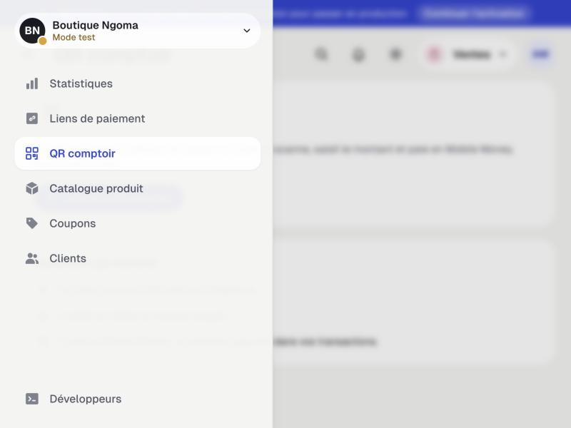
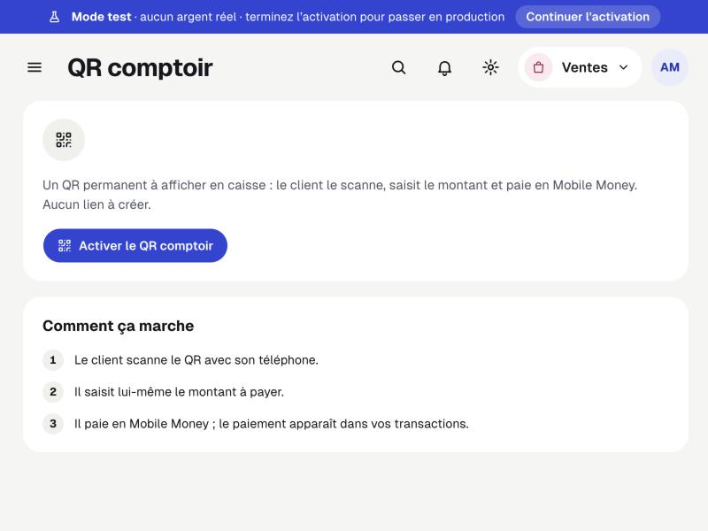
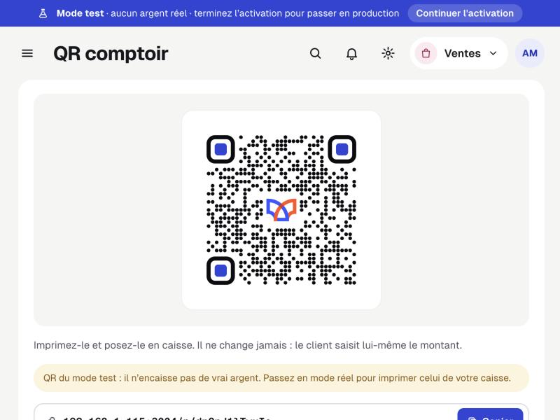
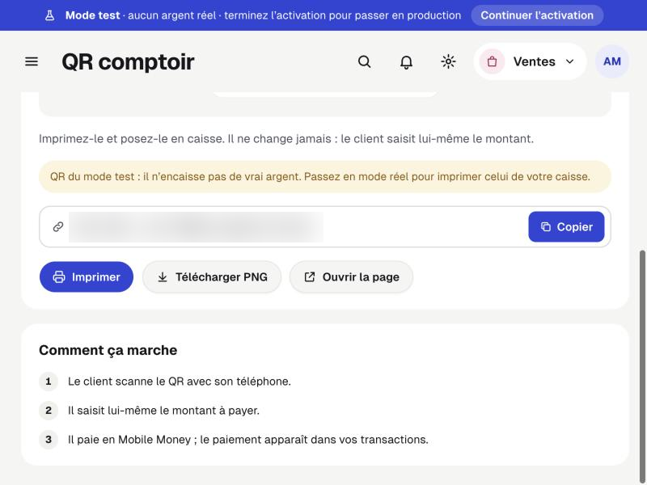
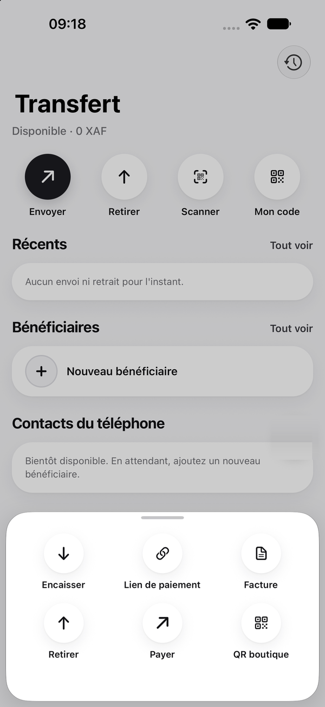
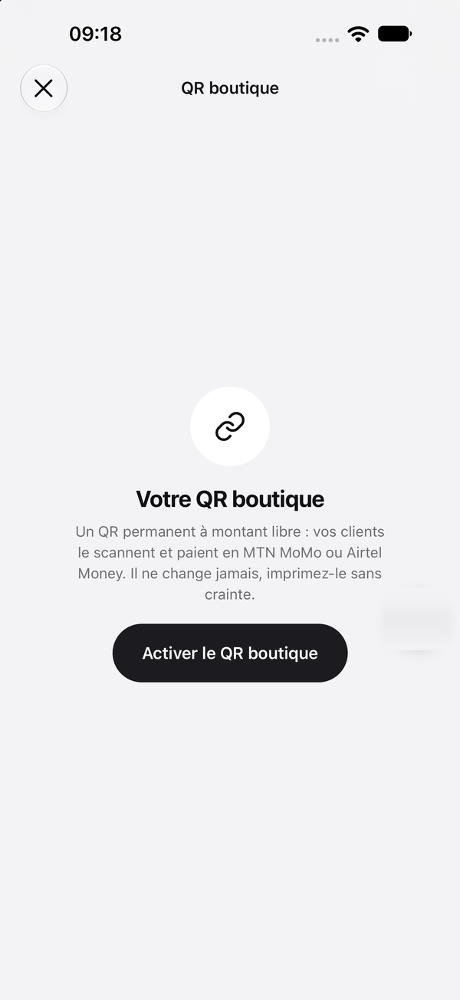
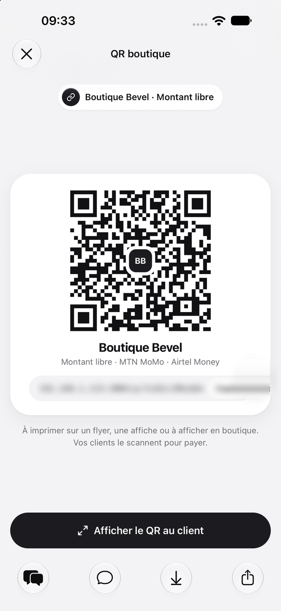
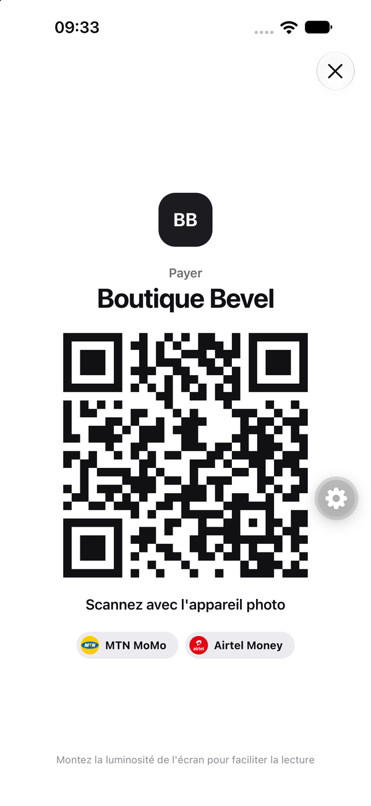
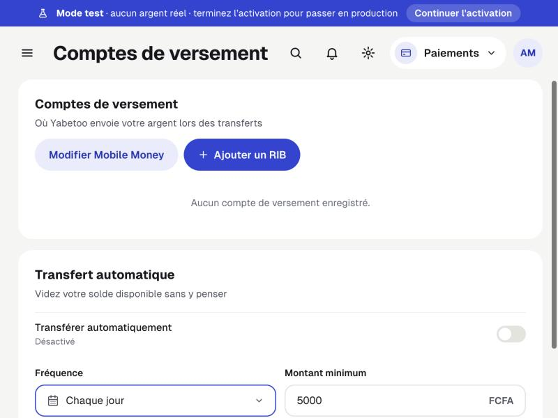
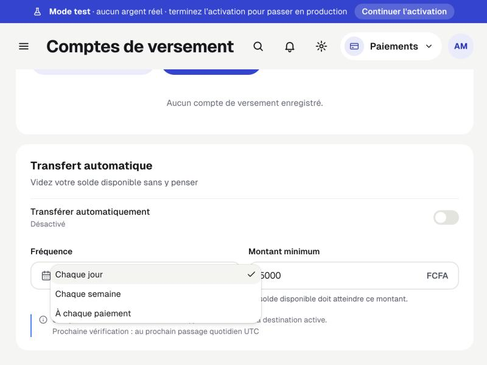

Le QR comptoir est un QR code **permanent**, propre à votre boutique. Vous l'imprimez une fois et le posez en caisse : le client le scanne avec son téléphone, **saisit lui-même le montant** et paie en MTN MoMo ou Airtel Money. Pas de lien à créer, pas de monnaie à rendre, et le QR ne change jamais.

<Info>
Tant que votre compte n'est pas activé, une bande « Mode test · aucun argent réel » s'affiche : rien de ce que vous faites n'encaisse de vrai argent. Les captures de cette page ont été faites en mode test.
</Info>

## Depuis le tableau de bord

<Steps>
  <Step title="Ouvrez « QR comptoir »">
    Connectez-vous sur [app.yabetoo.com](https://app.yabetoo.com). Dans l'espace **Ventes**, cliquez sur **QR comptoir** dans le menu (sur téléphone, le menu s'ouvre avec le bouton à trois traits en haut à gauche).
    <Frame></Frame>
  </Step>
  <Step title="Activez votre QR">
    Cliquez sur **Activer le QR comptoir**. Yabetoo crée votre QR en une seconde, rien d'autre à remplir.
    <Frame></Frame>
  </Step>
  <Step title="Votre QR est prêt">
    Le QR porte l'emblème Yabetoo. Il reste le même pour toujours : vous pouvez l'imprimer sans crainte.
    <Frame></Frame>
  </Step>
  <Step title="Imprimez-le ou téléchargez-le">
    **Imprimer** pour une affiche en caisse, **Télécharger PNG** pour un flyer ou un autocollant, **Copier** pour envoyer le lien de paiement par WhatsApp ou SMS.
    <Frame></Frame>
  </Step>
</Steps>

<Warning>
En mode test, la page affiche « QR du mode test ». Une fois votre compte activé, revenez sur cette page : c'est **le QR du mode réel** qu'il faut imprimer pour encaisser de vrais paiements.
</Warning>

## Depuis l'application Yabetoo Business

Dans l'application, le QR comptoir s'appelle **« QR boutique »**. C'est le même QR que sur le tableau de bord.

<Steps>
  <Step title="Bouton + puis « QR boutique »">
    Touchez le bouton **+** en bas de l'écran, puis **QR boutique**.
    <Frame></Frame>
  </Step>
  <Step title="Activez-le">
    Touchez **Activer le QR boutique**.
    <Frame></Frame>
  </Step>
  <Step title="Partagez ou enregistrez">
    Envoyez-le par WhatsApp ou SMS, téléchargez l'image, ou copiez le lien.
    <Frame></Frame>
  </Step>
  <Step title="Montrez-le au client">
    **Afficher le QR au client** le met en plein écran : le client le scanne directement sur votre téléphone.
    <Frame></Frame>
  </Step>
</Steps>

## Recevoir l'argent à chaque paiement

Par défaut, l'argent encaissé reste sur votre solde Yabetoo. Avec le versement **« À chaque paiement »**, Yabetoo l'envoie sur votre numéro Mobile Money juste après chaque paiement. Le SMS de votre opérateur (« Vous avez reçu… ») vous sert de confirmation : pas besoin de regarder l'écran du client.

<Steps>
  <Step title="Enregistrez votre numéro Mobile Money">
    Dans l'espace **Paiements**, ouvrez **Comptes de versement** et touchez **Modifier Mobile Money** pour indiquer le numéro qui recevra l'argent.
    <Frame></Frame>
  </Step>
  <Step title="Choisissez « À chaque paiement »">
    Dans **Transfert automatique**, activez **Transférer automatiquement** et choisissez la fréquence **À chaque paiement**. Le montant minimum indique à partir de quel solde l'argent part.
    <Frame></Frame>
  </Step>
</Steps>

<Info>
Le versement automatique ne fonctionne qu'en **mode réel**, une fois votre compte vérifié. Chaque versement suit le tarif de retrait habituel. Vous pouvez revenir à « Chaque jour » ou « Chaque semaine » à tout moment.
</Info>

## Ce que voit votre client

1. Il scanne le QR avec l'appareil photo de son téléphone.
2. Une page Yabetoo s'ouvre à votre nom : il saisit le montant à payer.
3. Il choisit MTN MoMo ou Airtel Money et valide avec son code secret sur son téléphone.
4. Le paiement apparaît dans vos transactions (et, en « À chaque paiement », arrive sur votre Mobile Money).
