Yabetoo POS transforme le terminal Android **ZCS Z91** en caisse : vous encaissez un montant libre ou les articles de votre catalogue, en Mobile Money ou par QR, et le ticket s'imprime tout seul.

## Avant de commencer

- un terminal Z91 chargé et connecté à Internet (Wi-Fi ou carte SIM) ;
- l'application **Yabetoo POS** sur le terminal : elle est installée par l'équipe Yabetoo à la livraison. Si l'icône manque, contactez le support Yabetoo ;
- votre compte Yabetoo (tableau de bord ou application Yabetoo Business).

Les mises à jour de l'application s'installent seules : elles se téléchargent en arrière-plan et s'appliquent au redémarrage suivant de l'application, jamais pendant une vente.

## 1. Relier le terminal à votre compte

<Steps>
  <Step title="Le terminal affiche un code">
    Ouvrez Yabetoo POS : un code à 8 chiffres et un QR s'affichent. Le code est valable 10 minutes (« Générer un nouveau code » sinon).
    <Frame>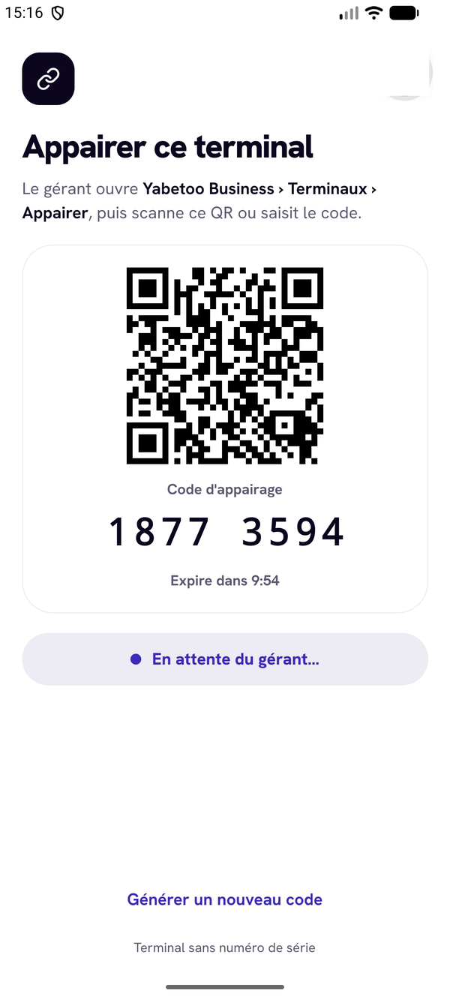</Frame>
  </Step>
  <Step title="Ouvrez « Terminaux POS »">
    Sur le tableau de bord, allez dans **Paramètres › Terminaux POS** et cliquez sur **Appairer un terminal**.
    <Frame>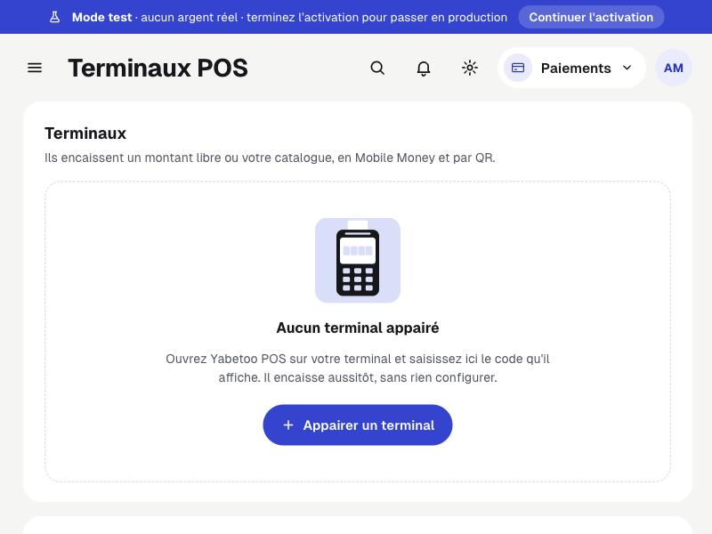</Frame>
  </Step>
  <Step title="Saisissez le code et nommez la caisse">
    Tapez le code affiché par le terminal, donnez-lui un nom (« Caisse 1 ») puis cliquez sur **Appairer**. Le terminal se connecte tout seul en quelques secondes.
    <Frame>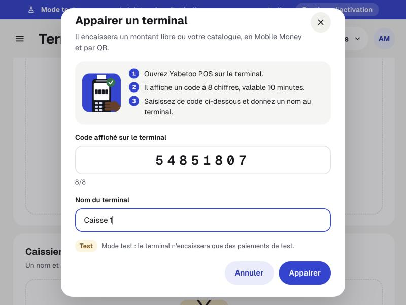</Frame>
  </Step>
</Steps>

<Tip>
Depuis l'application Yabetoo Business, c'est le même chemin : **Paramètres › Terminaux › Appairer un terminal**, puis visez le QR affiché par le terminal ou saisissez son code.
</Tip>

## 2. Créer vos caissiers

Chaque personne qui encaisse a son nom et son code PIN. Les caissiers valent pour tous les terminaux du compte.

<Steps>
  <Step title="Ajoutez un caissier">
    Dans **Terminaux POS**, cliquez sur **Ajouter un caissier** : son nom, son rôle et un PIN de 4 à 6 chiffres (pas de suite comme 1234, pas de chiffres identiques). Un **Responsable** peut en plus valider les remboursements avec son PIN.
    <Frame>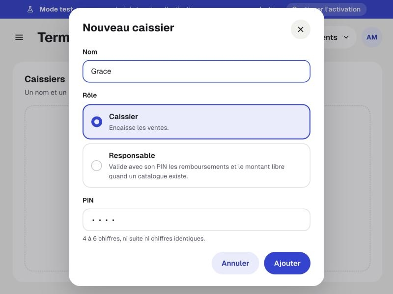</Frame>
  </Step>
  <Step title="Tout est prêt">
    Le terminal apparaît **Actif** et vos caissiers sont listés. Vous pouvez révoquer un terminal perdu ou modifier un caissier à tout moment.
    <Frame>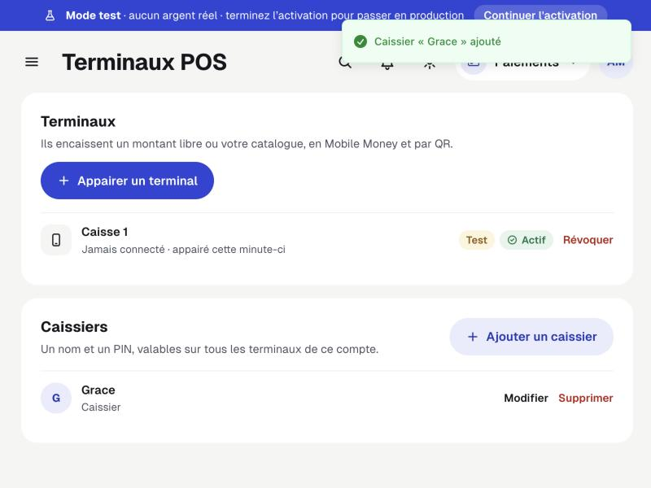</Frame>
  </Step>
</Steps>

## 3. Encaisser

<Steps>
  <Step title="Le caissier s'identifie">
    Au début de son service, il choisit son nom et tape son PIN. « PIN oublié ? » : demandez au gérant.
    <Frame>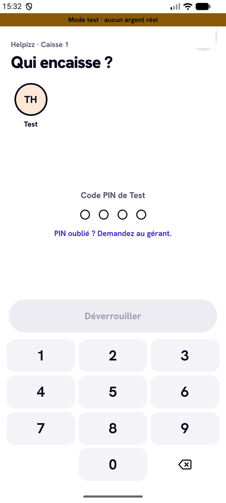</Frame>
  </Step>
  <Step title="Saisissez le montant ou ajoutez des articles">
    Tapez le montant sur le pavé (et un libellé si besoin), ou passez par l'onglet **Catalogue** : le panier se remplit en bas de l'écran.
    <CardGroup cols={2}>
      <Frame>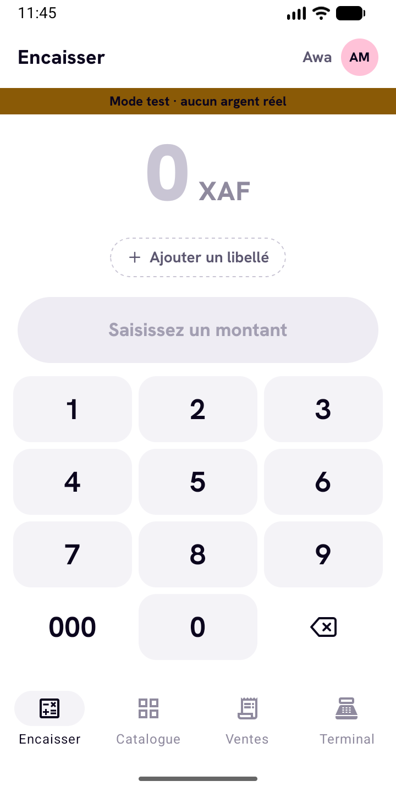</Frame>
      <Frame>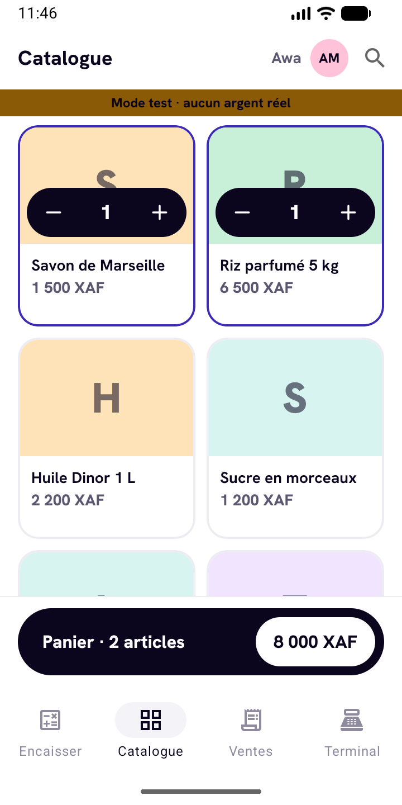</Frame>
    </CardGroup>
  </Step>
  <Step title="Choisissez le moyen de paiement">
    **Mobile Money** (le client valide sur son téléphone) ou **QR code** (le client scanne et paie).
    <Frame>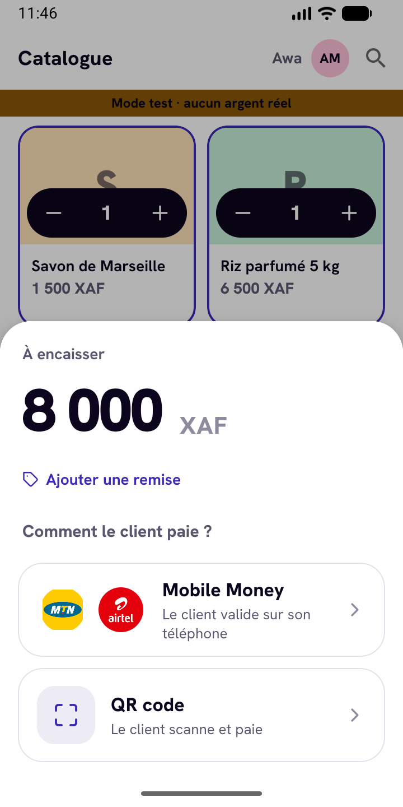</Frame>
  </Step>
  <Step title="Mobile Money : paiement reçu, ticket imprimé">
    Saisissez le numéro du client puis **Demander**. Le client valide avec son code secret ; dès que l'opérateur confirme, l'écran passe au vert et le ticket s'imprime. **Nouvelle vente** pour enchaîner.
    <CardGroup cols={2}>
      <Frame>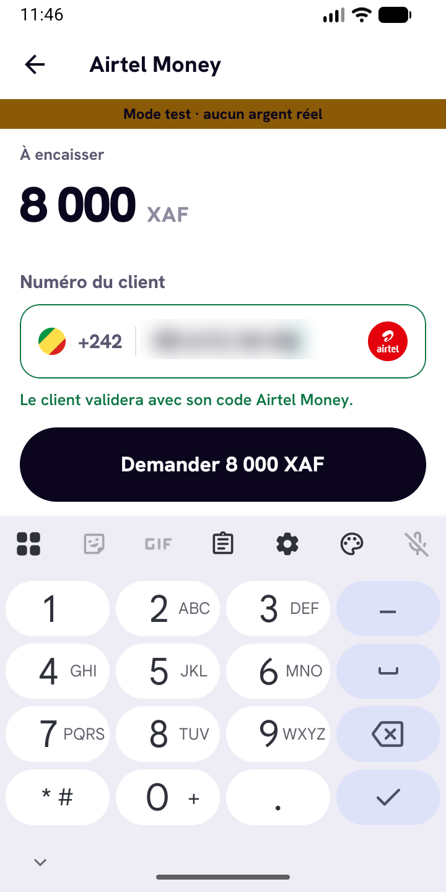</Frame>
      <Frame>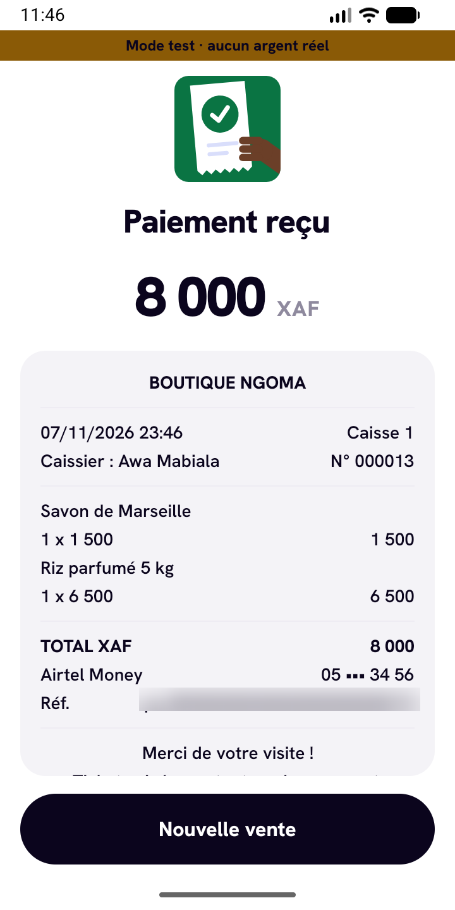</Frame>
    </CardGroup>
  </Step>
</Steps>

### Le QR à l'écran (QR dynamique)

Si le client préfère scanner, choisissez **QR code** : le terminal affiche un QR **au montant exact de la vente**, différent à chaque vente (contrairement au [QR comptoir](/fr/payments/in-store/counter-qr), permanent et à montant libre). Il reste valable quelques minutes ; « Annuler » ne ferme pas la vente : le QR reste payable jusqu'à son échéance. Le terminal détecte le paiement tout seul et imprime le ticket.

<CardGroup cols={2}>
  <Frame>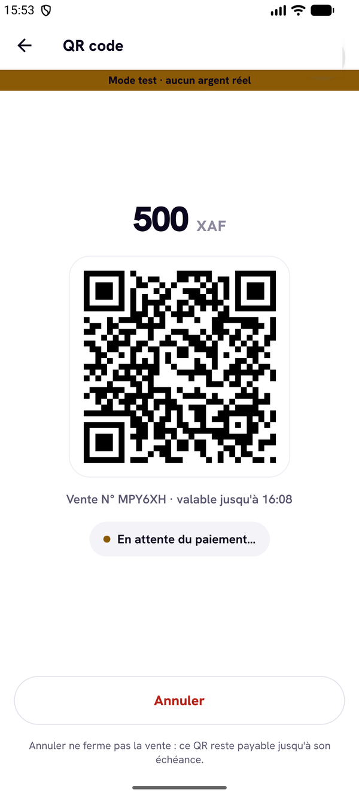</Frame>
  <Frame>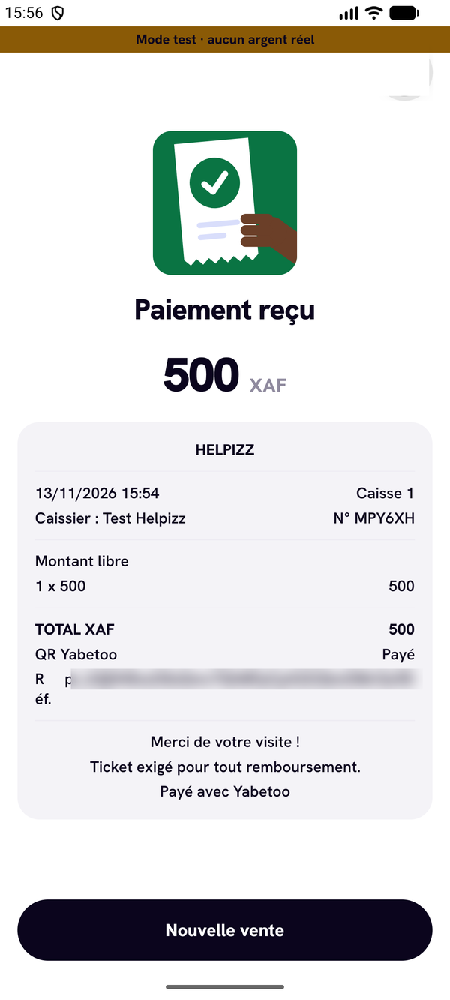</Frame>
</CardGroup>

## Les modes du terminal

Un terminal appairé depuis votre compte Yabetoo (tableau de bord ou Yabetoo Business) est en **mode normal** : montant libre et catalogue, paiement en Mobile Money ou par QR, sans espèces ni caisse à clôturer. Il encaisse tout de suite, sans rien configurer.

Les restaurants appairent leurs terminaux depuis **Takumi** : le terminal prend alors le mode de l'établissement (service rapide, à table, bar ou menu digital), avec espèces, tables et cuisine.

<Info>
**Rembourser une vente.** Ouvrez l'onglet **Ventes**, touchez la vente puis **Rembourser** : le PIN d'un Responsable est demandé, et l'argent repart vers le moyen de paiement d'origine. Gardez le ticket : il est exigé pour tout remboursement.
</Info>
